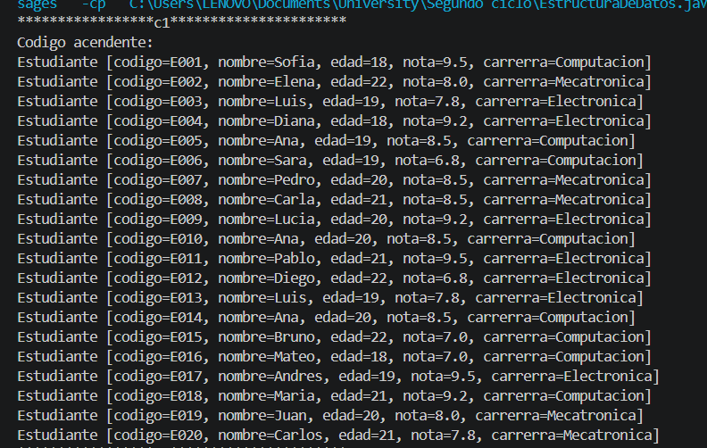
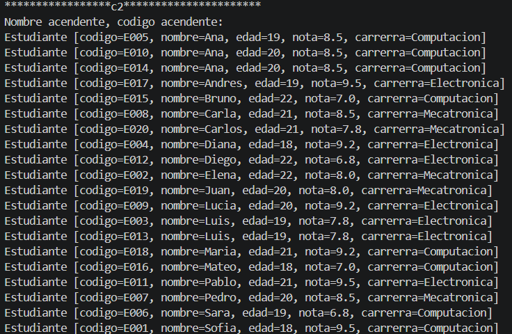
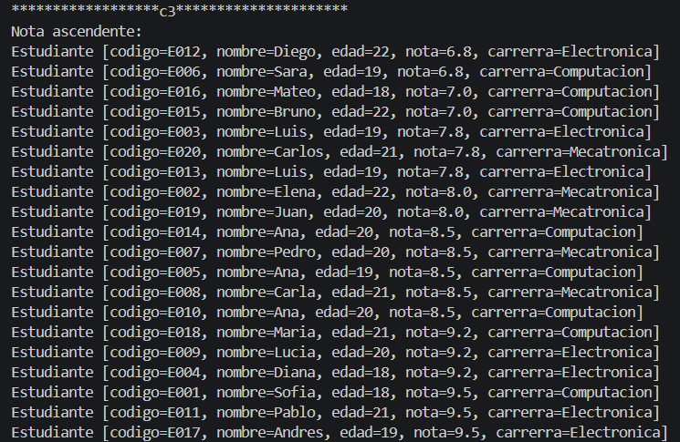
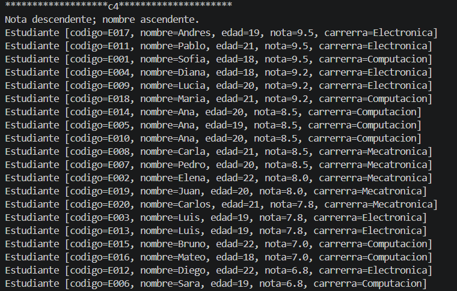
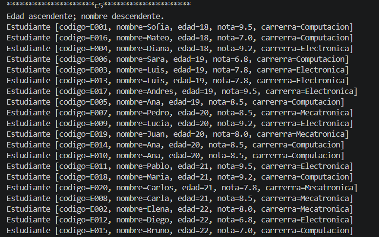
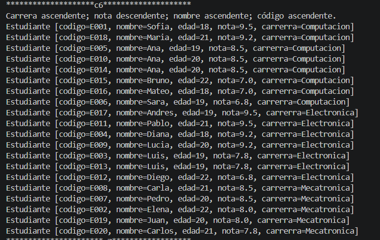
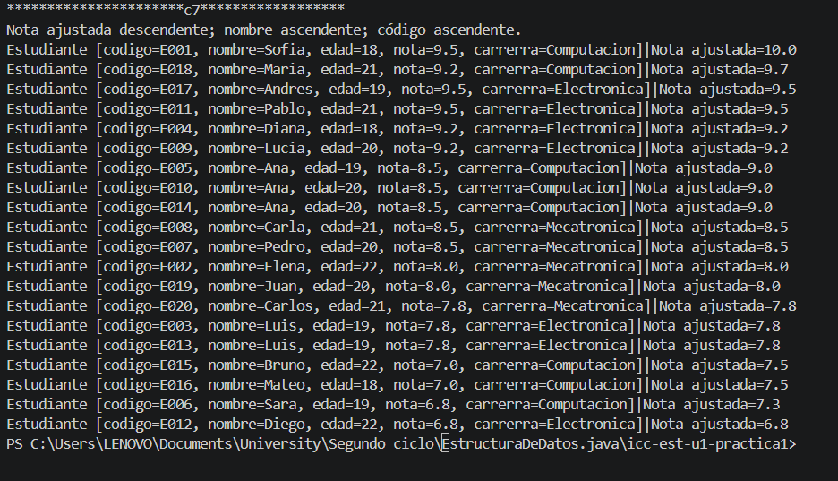

C1: Código ascendente.  Comparable y ordenamiento natural.

C2: Nombre ascendente; código ascendente.  Comparator con lambda de dos parámetros.

C3: Nota ascendente, sin desempate.   comparingDouble y referencia a método.

C4: Nota descendente; nombre ascendente.  reversed y thenComparing.

C5: Edad ascendente; nombre descendente.  comparingInt y sentido independiente para el criterio secundario.

C6: Carrera ascendente; nota descendente; nombre ascendente; código ascendente.  Composición de cuatro criterios.

C7: Nota ajustada descendente; nombre ascendente; código ascendente.  Lambda que calcule Math.min(10.0, nota + 0.5) para estudiantes de Computacion y conserve la nota de las demás carreras.

